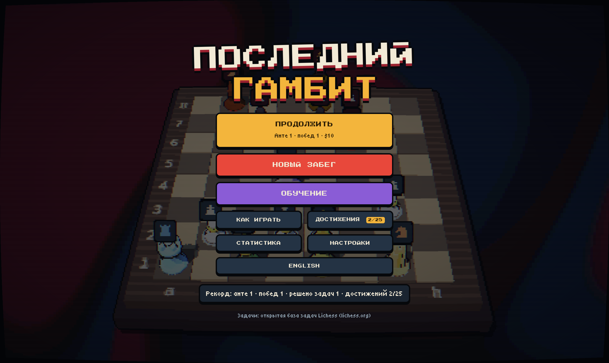
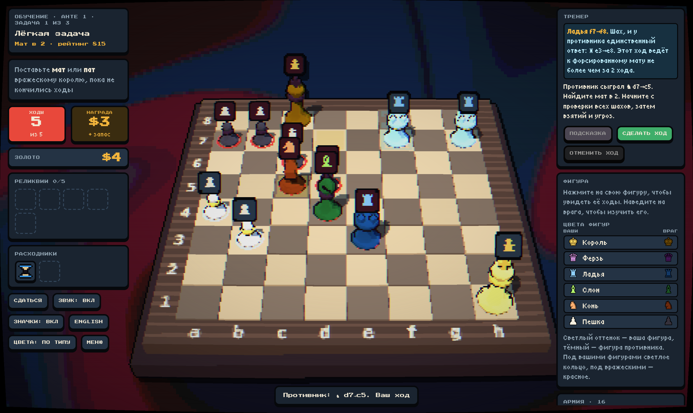
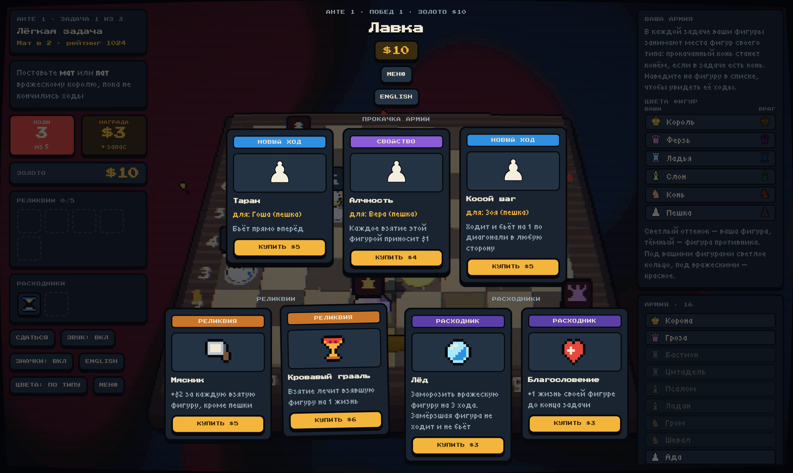
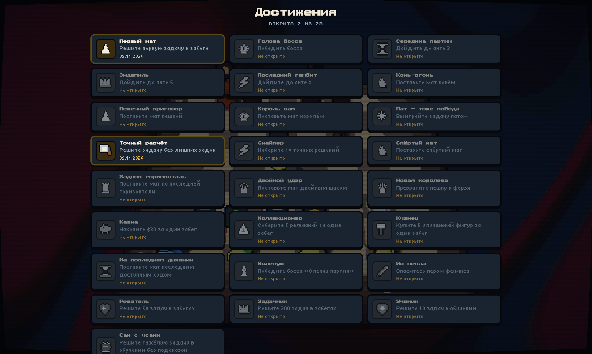

<div align="center">

# ♟ Последний гамбит

**Шахматный рогалик на настоящих задачах.** Ставьте мат за ограниченное число ходов, прокачивайте свои фигуры и играйте, пока не проиграете.

[Скачать](#скачать) · [Как играть](#как-играть) · [Режимы](#режимы) · [Прокачка](#прокачка) · [Достижения](#прогресс-и-достижения) · [Разработка](#разработка) · [English](#english)



</div>

## Скачать

Установщики лежат в разделе [Releases](../../releases/latest). Игра работает без интернета.

| Система | Файл | Примерный размер |
|---|---|---|
| Windows 10/11 | `Last Gambit_x.y.z_x64-setup.exe` | ~5 МБ |
| macOS (Apple Silicon) | `Last Gambit_x.y.z_aarch64.dmg` | ~7 МБ |
| macOS (Intel) | `Last Gambit_x.y.z_x64.dmg` | ~7 МБ |
| Linux | `.deb` (Ubuntu, Debian), `.rpm` (Fedora) или `.AppImage` | от ~5 МБ |

На macOS при первом запуске система может предупредить о неизвестном разработчике: нажмите на приложение правой кнопкой мыши и выберите «Открыть».

**Без установки:** скачайте `last-gambit.html` из релиза и откройте его двойным щелчком, или играйте в браузере на GitHub Pages по адресу `https://<ваш-ник>.github.io/<репозиторий>/` (включается в Settings → Pages → Source: GitHub Actions).

## Как играть

1. **Выберите задачу.** В каждом анте их три: лёгкая, средняя и тяжёлая. Тяжёлая — это босс со своим условием.
2. **Противник делает первый ход**, дальше ваша очередь.
3. **Поставьте мат или пат**, пока не кончились ходы. Компьютер защищается сам, а не по сценарию.
4. **За победу вы получаете золото** и тратите его в лавке. Одно поражение заканчивает забег.



**Свои и чужие фигуры видно сразу.** У каждого типа фигуры свой цвет: светлый оттенок — ваша фигура, тёмный — фигура противника. Например, салатовый слон ваш, тёмно-зелёный — вражеский. Под вашими фигурами светлое кольцо, под вражескими — красное. Если удобнее по-старому, есть классическая расцветка: светлые против красных.

## Режимы

| | Забег | Обучение |
|---|---|---|
| Подсказки с объяснениями | — | ✓ |
| Отмена ходов | только расходником | бесплатно |
| После поражения | забег окончен | повтор задачи или следующая |
| Рекорд | записывается | не записывается |

**Тренер в обучении** подсказывает в два шага: сначала идею («ищите шах»), потом сам ход и объяснение. Он объясняет шахи, жертвы, тихие ходы и типы матов, комментирует ответы противника и предупреждает, если ваш ход упустил вынужденный мат.

## Прокачка



Ваша армия — 16 фигур с именами. В каждой задаче они встают на места фигур своего типа: прокачанный конь Гром станет конём в любой задаче, где есть конь.

- **Новые ходы.** Пешка учится ходить назад и вбок, конь — прыгать «верблюдом» 3×1, ферзь становится «амазонкой» и ходит ещё и конём.
- **Жизни.** Если фигуру с несколькими жизнями бьют, она теряет одну жизнь и остаётся на месте.
- **Свойства.** «Жажда» даёт +1 ход за каждое взятие, «Алчность» — +$1.
- **Реликвии** меняют правила: «Песочные часы» дают +2 хода в каждой задаче, «Перо феникса» один раз спасает от поражения, «Утренний кофе» делает первый ход бесплатным.
- **Расходники** выручают в трудную минуту: «Лёд» замораживает фигуру врага, «Молот» разбивает его пешку, «Перемотка» отменяет ход.

## Прогресс и достижения

Забег сохраняется автоматически: закройте игру между задачами и продолжите с того же места из главного меню. Если выйти посреди задачи, она начнётся заново.

В меню есть 25 достижений: от первого мата до анте 8, мата конём, спёртого мата и мата последним доступным ходом. Там же статистика: лучший анте, решённые задачи, точные решения, побеждённые боссы, время в партиях. Обучение не влияет на рекорды и достижения забега, у него свои два достижения.

В настройках можно выбрать язык, громкость, расцветку фигур, значки над фигурами, полноэкранный режим и выключить эффект старого экрана.



## Управление

| Действие | Как |
|---|---|
| Ход | нажмите на фигуру, затем на клетку |
| Снять выбор | Esc или правая кнопка мыши |
| Подсказка (обучение) | H |
| Отменить ход (обучение) | Z |
| Значки над фигурами | B |
| Цвета: по типу или классика | C |

Язык (русский или английский) переключается кнопкой на любом экране.

## Задачи

871 задача на мат в 2–6 ходов из открытой [базы задач Lichess](https://database.lichess.org/#puzzles). Каждая проверена перебором: мат вынужден при любой защите компьютера.

| Уровень | Задач | Что входит |
|---|---|---|
| Лёгкие | 318 | мат в 2, рейтинг до 1250 |
| Средние | 310 | мат в 2 до 1750 и простые маты в 3 |
| Тяжёлые | 243 | маты в 3–6 и сложные маты в 2 |

С каждым анте задачи берутся всё ближе к верху рейтинга, а за один забег задачи не повторяются.

## Разработка

Игра написана на JavaScript и Three.js, десктопная оболочка — [Tauri 2](https://tauri.app) на Rust. Нужны Node.js 22 и, для сборки приложения, Rust.

```bash
npm install
npm run dev          # игра в браузере на http://localhost:1420
npm test             # проверка движка и всех задач
npm run app:dev      # десктопное приложение в режиме разработки
npm run app:build    # установщик для вашей системы
npm run build:single # dist-single/index.html — вся игра в одном файле
```

На Linux для сборки приложения нужны системные библиотеки: `libwebkit2gtk-4.1-dev libappindicator3-dev librsvg2-dev patchelf`.

| Папка | Что внутри |
|---|---|
| `src/engine.js` | правила шахмат с улучшениями фигур, компьютер, поиск вынужденного мата |
| `src/game.js` | 3D-сцена, ход партии, лавка, тренер |
| `src/meta.js` | заставка, главное меню, экраны достижений, статистики и настроек |
| `src/achievements.js` | список достижений и условия их получения |
| `src/storage.js` | профиль игрока: в приложении файл `profile.json`, в браузере localStorage |
| `src/i18n.js`, `src/strings-meta.js` | тексты на русском и английском |
| `data/puzzles.json` | банк задач по трём уровням |
| `src-tauri/` | десктопная оболочка и настройки сборки |

**Новое достижение** добавляется в два шага: строка в массиве `ACHIEVEMENTS` в `src/achievements.js` (иконка — буква фигуры `K Q R B N P` или название пиксельной иконки из `src/content.js`) и вызов `unlock('id')` в подходящем событии функции `track()`. Игра сообщает о победах, анте, покупках, превращениях пешек и других событиях — список в комментарии над `track()`.

**Релиз:** поднимите версию в `package.json`, `src-tauri/tauri.conf.json` и `src-tauri/Cargo.toml`, затем отправьте тег, например `git tag v0.5.0 && git push --tags`. GitHub Actions соберёт установщики для всех систем и создаст черновик релиза.

## Лицензия

Код и графика игры распространяются по лицензии [MIT](LICENSE). Задачи взяты из базы Lichess (CC0, общественное достояние), Three.js — по лицензии MIT, шрифты Press Start 2P и Tiny5 — по SIL Open Font License.

---

## English

**The Last Gambit** is a chess roguelike built on real mate puzzles. Each ante has three puzzles: easy, medium and a hard boss. The opponent makes the first move, then you have a limited number of moves to deliver mate or stalemate. Wins pay gold to upgrade specific pieces of your 16-piece army with new moves, extra lives and traits, or to buy relics that bend the rules. One loss ends the run.

**Training mode** adds a coach. Hints come in two steps: first the idea, then the move with an explanation. The coach comments on the opponent's replies and warns you when a move throws away a forced mate. Undo is free, failed puzzles can be retried, and records are not saved.

**Download** the installer for Windows, macOS or Linux from [Releases](../../releases/latest) (about 5–7 MB, works offline), or play the browser version on GitHub Pages. Runs are saved automatically, and the main menu has 25 achievements, lifetime statistics and settings. Switch to English in Settings or with the button on any screen. Every piece type has its own color: a light shade for yours and a dark shade for the opponent.

**Building from source:** `npm install`, then `npm run dev` for the browser or `npm run app:build` for a desktop installer (needs Rust). Push a `v*` tag and GitHub Actions builds installers for all three systems.

Puzzles come from the open [Lichess puzzle database](https://database.lichess.org/#puzzles). 3D rendering uses [Three.js](https://threejs.org). Code and art are under the [MIT license](LICENSE).
