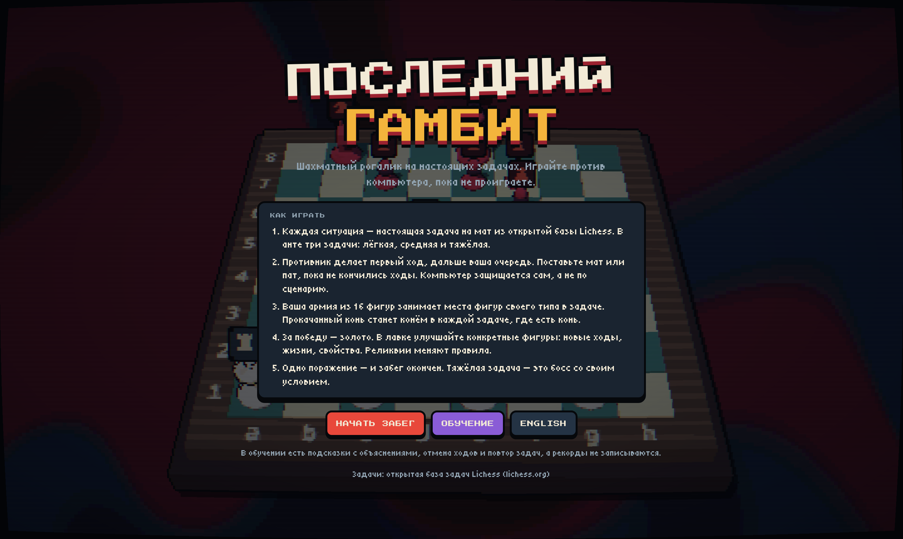

# ♟ Последний гамбит

**Шахматный рогалик на настоящих задачах.** Ставьте мат за ограниченное число ходов, прокачивайте свои фигуры и играйте, пока не проиграете.

[Как играть](#как-играть) · [Режимы](#режимы) · [Прокачка](#прокачка) · [Запуск](#запуск) · [English](#english)

## Как играть

1. **Выберите задачу.** В каждом анте их три: лёгкая, средняя и тяжёлая. Тяжёлая — это босс со своим условием.
2. **Противник делает первый ход**, дальше ваша очередь.
3. **Поставьте мат или пат**, пока не кончились ходы. Компьютер защищается сам, а не по сценарию.
4. **За победу вы получаете золото** и тратите его в лавке. Одно поражение заканчивает забег.

## Режимы

| | Забег | Обучение |
|---|---|---|
| Подсказки с объяснениями | — | ✓ |
| Отмена ходов | только расходником | бесплатно |
| После поражения | забег окончен | повтор задачи или следующая |
| Рекорд | записывается | не записывается |

**Тренер в обучении** подсказывает в два шага: сначала идею («ищите шах»), потом сам ход и объяснение. Он объясняет шахи, жертвы, тихие ходы и типы матов, комментирует ответы противника и предупреждает, если ваш ход упустил вынужденный мат.

## Прокачка

Ваша армия — 16 фигур с именами. В каждой задаче они встают на места фигур своего типа: прокачанный конь Гром станет конём в любой задаче, где есть конь.

- **Новые ходы.** Пешка учится ходить назад и вбок, конь — прыгать «верблюдом» 3×1, ферзь становится «амазонкой» и ходит ещё и конём.
- **Жизни.** Если фигуру с несколькими жизнями бьют, она теряет одну жизнь и остаётся на месте.
- **Свойства.** «Жажда» даёт +1 ход за каждое взятие, «Алчность» — +$1.
- **Реликвии** меняют правила: «Песочные часы» дают +2 хода в каждой задаче, «Перо феникса» один раз спасает от поражения, «Утренний кофе» делает первый ход бесплатным.
- **Расходники** выручают в трудную минуту: «Лёд» замораживает фигуру врага, «Молот» разбивает его пешку, «Перемотка» отменяет ход.

## Управление

| Действие | Как |
|---|---|
| Ход | нажмите на фигуру, затем на клетку |
| Снять выбор | Esc или правая кнопка мыши |
| Подсказка (обучение) | H |
| Отменить ход (обучение) | Z |
| Значки над фигурами | B |

Язык (русский или английский) переключается кнопкой на любом экране.

## Запуск

Вся игра — один файл `index.html`, сборка не нужна.

- **На компьютере:** скачайте `index.html` и откройте его двойным щелчком.
- **Через GitHub Pages:** включите Pages для ветки `main` (Settings → Pages), и игра откроется по адресу репозитория.

При первом запуске нужен интернет, чтобы загрузить Three.js и шрифты.

## Задачи

871 задача на мат в 2–6 ходов из открытой [базы задач Lichess](https://database.lichess.org/#puzzles). Каждая проверена перебором: мат вынужден при любой защите компьютера.

| Уровень | Задач | Что входит |
|---|---|---|
| Лёгкие | 318 | мат в 2, рейтинг до 1250 |
| Средние | 310 | мат в 2 до 1750 и простые маты в 3 |
| Тяжёлые | 243 | маты в 3–6 и сложные маты в 2 |

С каждым анте задачи берутся всё ближе к верху рейтинга, а за один забег задачи не повторяются.

---

## English

**The Last Gambit** is a chess roguelike built on real mate puzzles. Each ante has three puzzles: easy, medium and a hard boss. The opponent makes the first move, then you have a limited number of moves to deliver mate or stalemate. Wins pay gold to upgrade specific pieces of your 16-piece army with new moves, extra lives and traits, or to buy relics that bend the rules. One loss ends the run.

**Training mode** adds a coach. Hints come in two steps: first the idea, then the move with an explanation. The coach comments on the opponent's replies and warns you when a move throws away a forced mate. Undo is free, failed puzzles can be retried, and records are not saved.

To play, download `index.html` and open it in a browser, or enable GitHub Pages for this repository. Switch to English with the button on any screen. The game needs internet on first launch to load Three.js and fonts.

Puzzles come from the open [Lichess puzzle database](https://database.lichess.org/#puzzles). 3D rendering uses [Three.js](https://threejs.org).
